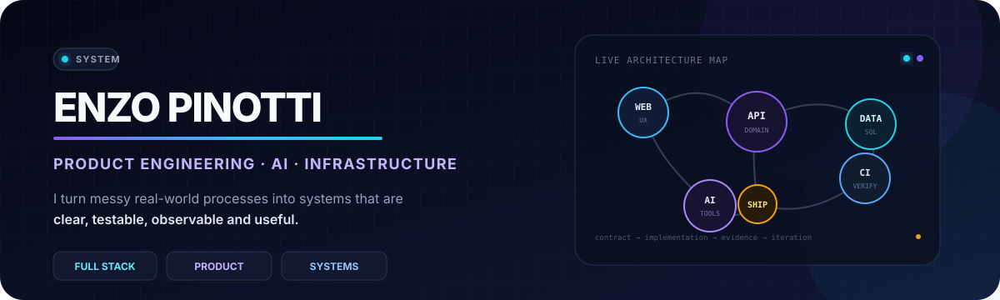

  <picture>
    <source media="(prefers-color-scheme: dark)" srcset="./assets/enzo-engineering-hero.svg">
    <source media="(prefers-color-scheme: light)" srcset="./assets/enzo-engineering-hero-light.svg">
    
  </picture>

<h1 align="center">Enzo Pinotti</h1>

<strong>Full-Stack / Product Engineer · Systems Analyst / Technical Lead</strong>

Industrial Engineer · Systems Engineering in progress · La Plata, Argentina · English B2

  <a href="https://enzopinotti.dev">Portfolio</a> ·
  <a href="mailto:enzopinottii@gmail.com">Email</a>

## What I do

I connect **business ↔ technology**: requirements, **BPMN / AS-IS / TO-BE**, architecture, hands-on development and **QA/UAT** through release. My work spans full-stack products, data, integrations and operational software. At **Fedes** I have worked across engineering and systems analysis; at **GIDAS** across data, reporting and coordination.

## Building now

- **Rundda (Podómetro)** · *Private · active development* — Mobile activity and walking product built with **Expo/React Native, Node.js and PostgreSQL**. On-device step tracking, GPS sessions, goals and social features; native and production verification are still in progress.
- **[Los Apuntes](https://github.com/Enzopinotti/losApuntes)** · *Public · active development* — Mobile-first university network connecting notes, courses, academic communities and discovery. Built around shared contracts, contextual search and privacy-aware access.
- **AnyConsole Web** · *Private · research preview* — Local-first console compatibility research with a **React interface, Rust host and an original PS2-oriented experimental core**. Its current demo runs synthetic programs, **not commercial games or imported ISOs**.
- **TOP** · *Private · beta development* — Modular operational software designed to adapt to different business domains, with role-aware experiences, permissions and focused workflows.

## Selected public work

- **[Meow Matrix](https://github.com/Enzopinotti/MeowMatrix---Backend-2v)** ([frontend](https://github.com/Enzopinotti/Meow-Matrix---Frontend)) — Full-stack ecommerce architecture, backend-owned authentication, transactional order flows and Docker-based release work.
- **[Antigal — UTN team project](https://github.com/Enzopinotti/2024-UTN-GRUPO-2)** — Collaborative React + .NET application modernized with tests, security boundaries and preserved team attribution.
- **[El Núcleo](https://github.com/Enzopinotti/El_Nucleo_Web)** — Modernized web experience with preserved historical source, accessible delivery and reproducible production builds.

More projects

[Pint.ar](https://github.com/Enzopinotti/Pint.ar_Ecommerce) · [Modderhouse](https://github.com/Enzopinotti/Web-de-profesores) · [Bitora](https://github.com/Enzopinotti/Bitora) · [Mora Petraglia](https://github.com/Enzopinotti/Mora-Petraglia-Landing) · [Portfolio source](https://github.com/Enzopinotti/portafolio-personal)

For the earlier repository modernization program, see the [Repository portfolio roadmap — 2026](./docs/repository-portfolio-roadmap-2026.md) (historical snapshot).

## Toolkit

**Product & delivery:** process analysis, requirements, stakeholder coordination, APIs, QA/UAT, releases.

**Engineering:** React, React Native, TypeScript, Node.js, Python, SQL/PostgreSQL, MongoDB, Docker, GitHub Actions, Linux/VPS and AI integrations.

## Contribution activity

  <picture>
    <source media="(prefers-color-scheme: dark)" srcset="./profile-3d-contrib/profile-enzo-dark.svg?v=a955184d93e4">
    <source media="(prefers-color-scheme: light)" srcset="./profile-3d-contrib/profile-enzo-light.svg?v=a955184d93e4">
    
  </picture>

Automatically refreshed daily and when this profile changes. GitHub Actions may run late; this is not a live feed. The chart reflects the contribution data available to its generator.

---

Build what matters. Verify what ships. Keep learning.

